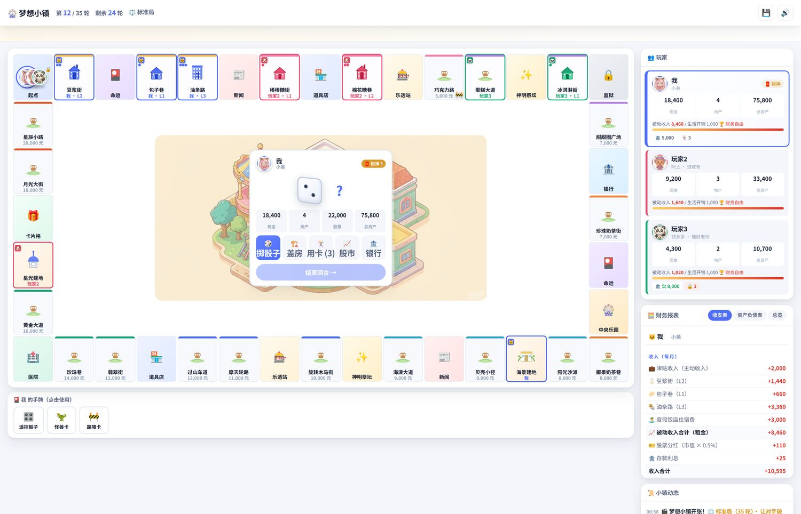
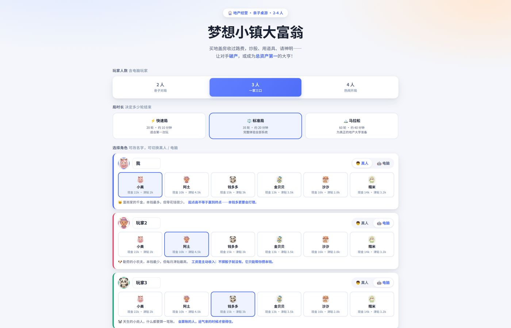
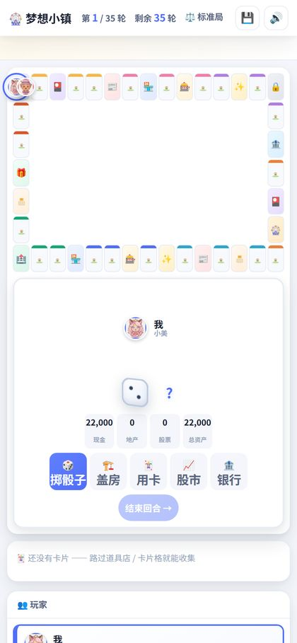

# 🎡 梦想小镇大富翁 · Dream Town Tycoon

> 一款给 **6–14 岁孩子和家庭**玩的地产经营桌游。
> 买地盖房收过路费、炒股、用道具卡、请神明附身——在玩中看懂**资产、现金流与风险**。

🎮 **在线试玩**：<https://chillsann.github.io/cashflow-kids/>



---

## 为什么做这个游戏

市面上的大富翁类游戏很多，但大多是纯运气。这一款做了两件事：

**① 玩法参照经典《大富翁》系列**（买地、盖房、收租、股票、卡片道具、神明附身、命运新闻、乐透），
目标明确、节奏明快：**让对手破产，或轮数走完时总资产最高。**

**② 把财商教育藏在玩法里。** 屏幕右侧常驻一张**真实的财务报表**——
孩子每买一块地、每盖一层楼、每借一笔贷款，都会在报表上留下痕迹。
玩十局下来，他会自己悟出：租金才是「睡着了也在赚的钱」，而贷款是每个月都要还的债。



---

## 玩法速览

### 🎯 胜利条件
- **让其他所有玩家破产**（地产归债主）→ 立即获胜
- 或**轮数走完时总资产最高**（现金 + 存款 + 地产 + 股票 − 贷款）

### 🗺️ 40 格环形地图 · 8 个街区

| 格子 | 作用 |
| --- | --- |
| 🚩 **起点** | 经过领津贴；**停驻**领双倍 + 奖励 |
| 🏠 **地产格**（22 块） | 无主可买；自己的可加盖 L1→L4；对手落上交过路费 |
| 🏗️ **大型建地**（2 块） | 可盖公园 / 加油站 / 研究中心 / 度假饭店 |
| 🏦 **银行** | 存款生息、贷款付息，还能抵押地产周转 |
| 📈 **证券所** | 4 只股票，低买高卖 + 每轮分红 |
| 🃏 **道具店 / 卡片格** | 买卡、捡卡，12 种功能卡 |
| ✨ **神明祭坛** | 财神 / 福神 / 穷神 / 衰神随机附身 |
| 🎴 **命运** | 个人事件，好事坏事各半 |
| 📰 **新闻** | 全体事件（含股价暴涨暴跌、旅游旺季） |
| 🎰 **乐透站** | 500 元一张，每 5 轮开奖，奖池累加 |
| 🔒 **监狱 / 🏥 医院** | 被陷害后停留 2 / 3 回合，可用点券保释 |
| 🎡 **中央乐园** | 休息一下，领 2 张点券 |

### ⚡ 垄断是核心策略
集齐**同一条街区的全部地块** → 该街区租金 **×2**。
这是拉开差距最快的方式，也是 AI 最想破坏的事。

### 🃏 12 种功能卡（致敬经典）

| 卡片 | 效果 |
| --- | --- |
| 🎛️ 遥控骰子 | 指定下次掷骰点数 |
| 📜 购地卡 | 直接买下任意无主地块 |
| 🔄 换地卡 | 与对手交换地块 |
| 🦝 抢夺卡 | 抢走对手一张手牌 |
| 💤 梦游卡 | 对手下回合无法行动 |
| 🦖 怪兽卡 | 拆掉对手一层建筑 |
| 💣 炸弹卡 | 炸平建筑并把主人送进医院 |
| 🚧 路障卡 | 放置路障，让对手被迫停下 |
| 🤖 机器娃娃 | 清除全场所有路障 |
| 🛡️ 免费卡 | 免除下一次支出（保险思维） |
| 😇 天使卡 | 驱散身上的坏神 |
| ⚖️ 均富卡 | 全体现金平均分配（落后时的翻盘牌） |

### ✨ 神明附身

| 神明 | 效果 |
| --- | --- |
| 🧧 财神 | 附身期间所有收入 **×2** |
| 🛡️ 福神 | 厄运事件与坏卡对你无效 |
| 🕳️ 穷神 | 附身期间所有收入 **减半** |
| 🌩️ 衰神 | 每回合扣 500 元，且受伤害翻倍 |

### 👥 6 位角色（初始资金 × 津贴，各有取舍）

| 角色 | 初始现金 | 津贴 | 特点 |
| --- | ---: | ---: | --- |
| 🐱 小美 | 22,000 | 2,000 | 本钱最厚，但每月进账最少 |
| 🐶 阿土 | 10,000 | 4,500 | 本钱最少，却最能赚钱 |
| 🐼 钱多多 | 15,000 | 3,000 | 均衡型小商人 |
| 🐣 金贝贝 | 13,000 | 3,500 | 起手偏稳健 |
| 🦊 沙沙 | 16,000 | 2,800 | 现金宽裕型 |
| 🐹 糯米 | 14,000 | 3,200 | 万金油 |

> 💡 **教学点**：小美和阿土谁更强？存款多的人怕通胀，工资高的人怕失业——
> 这局玩完，孩子会自己给出答案。

### ⚡ 三种局时长
快速局（20 轮 / 约 10 分钟）· 标准局（35 轮 / 约 20 分钟）· 马拉松（60 轮 / 约 40 分钟）

---

## 🧮 教育内核：两张真实的财务报表

屏幕右侧随时可查，**点击玩家卡即可切换对比**：

### 收支表（Income Statement）
```
收入（每月）
  💼 津贴收入（主动收入）        +2,000
  🥛 豆浆街（L2）                +1,440
  🌯 油条路（L3）                +3,360
  🏝️ 度假饭店住宿费              +3,000
  📈 被动收入合计（租金）        +6,460
  🎫 股票分红（市值 × 0.5%）       +110
  🏦 存款利息                      +25
  收入合计                     +10,505

支出（每月）
  🍚 生活开销                   −1,000
  🏦 贷款利息（2% / 月）          −160
  支出合计                     −1,160

💰 每月净现金流                 +9,345
🎯 财务自由：被动收入 ÷ 生活开销   646%
```

### 资产负债表（Balance Sheet）
```
资产
  💵 现金                       18,400
  🏦 银行存款                    5,000
  🥛 豆浆街（L2）                6,600
  🌯 油条路（L3）               22,000
  🏝️ 度假饭店                   12,000
  🍬 糖果股份（400 股）          9,600
  资产合计                      75,800

负债
  🏦 银行贷款                        0
  🏛️ 净资产（总资产）            75,800
```

> **给孩子的一句话**：现金流是**水管**，净资产是**水池**。
> 水管越粗，水池迟早会满——先让租金变多。

每个玩家的卡片上还有一条**财务自由进度条**：
当单圈租金收入盖过生活开销，就点亮「🏆 财务自由」标记。
（注意：这条线**不参与胜负判定**，它存在只是为了让孩子看见「钱在替你工作」的那一刻。）



---

## ✨ 功能特性

- 🏗️ **SVG 参数化建筑**：空地「出售」木牌 → L1 小屋 → L2 洋房 → L3 大厦 → L4 酒店（金字招牌 + 旗帜），同一函数随等级变形
- 🎨 **AI 生成角色立绘**：6 位角色的头像由 AI 绘制，加载失败自动回退 emoji（永不坏链）
- 🧩 **8 街区色带** + 产权小旗 + 房屋等级点标 + 抵押锁标记，一眼看清版图
- 🎲 **3D CSS 骰子**，真实翻滚动画
- 🪙 **金币飞行动画**：付租、买地、股票卖出时金币从付款方飞向收款方
- 🀄 **持久棋子 + 平滑移动**：逐格跳动、落格弹跳，破产变灰
- 🤖 **5 种 AI 人格**（谨慎先生 / 平衡小姐 / 进取哥 / 机会猎手 / 理财老师），三层决策：地产垄断 → 股票均值回归 → 卡片情境触发
- 📈 **SVG 走势图**：4 只股票的实时行情与持仓浮盈浮亏
- 💾 **自动存档**（localStorage），刷新可续
- 📱 **完整响应式**：手机端操作台自动改为棋盘下方横条，不遮挡棋盘
- 🔊 **WebAudio 程序合成音效**，零音频文件
- ♿ 支持 `prefers-reduced-motion`、键盘操作
- ⚡ **零依赖**，纯原生 HTML + CSS + JavaScript，无需构建

---

## 🚀 本地运行

直接用浏览器打开 `index.html` 即可玩。

如遇浏览器本地文件限制，可起个静态服务器：

```bash
python -m http.server 8000     # 或 npx serve .
```

然后访问 <http://localhost:8000>

### 部署到 GitHub Pages
`Settings → Pages → Source: Deploy from a branch → main / (root)`

---

## 📁 项目结构

```
cashflow-kids/
├── index.html            页面结构（设置屏 + 游戏屏 + 弹窗 + 结算屏）
├── css/
│   ├── style.css         设计系统：配色 / 按钮 / 设置屏 / 弹窗 / 结算
│   ├── board.css         棋盘：格子 / 街区色带 / 棋子 / 金币 / 3D 骰子
│   └── hud.css           操作台 / 玩家卡 / 手牌 / 财务报表
├── js/
│   ├── data/
│   │   ├── world.js      📚 40 格地图 · 8 街区 · 6 角色 · 平衡常量（改这里调内容）
│   │   └── content.js    📚 4 只股票 · 12 张卡片 · 4 位神明 · 命运 / 新闻事件池
│   ├── audio.js          🔊 WebAudio 程序合成音效
│   ├── ui.js             🎨 弹窗系统 / toast / 日志 / 金币动画 / 头像组件 / 引导
│   ├── board.js          🎲 棋盘渲染 / SVG 建筑 / 棋子 / 3D 骰子
│   ├── hud.js            📊 操作台 / 玩家卡 / 手牌栏
│   ├── report.js         🧮 财务报表（收支表 / 资产负债表 / 对比表）
│   ├── game/
│   │   ├── engine.js     ⚙️ 状态机 / 回合循环 / 移动 / 落格调度 / 胜负
│   │   ├── estate.js     🏠 买地 / 盖房 / 收租 / 垄断 / 抵押 / 破产清算
│   │   ├── finance.js    🏦 银行 / 股票行情与交易 / 乐透
│   │   ├── cardsys.js    🃏 卡片效果注册表 / 道具店 / 神明 / 命运新闻 / 监狱
│   │   ├── ai.js         🤖 三层 AI 决策
│   │   └── save.js       💾 存档
│   └── main.js           🚪 入口：设置屏与事件绑定
├── assets/
│   ├── img/              角色头像（AI 生成）+ 棋盘中心插画
│   └── screens/          README 配图
├── README.md
└── LICENSE
```

---

## 🛠️ 自定义（老师 / 家长向）

**所有游戏内容都集中在 `js/data/` 两个文件里**，不需要懂编程也能改：

| 想改什么 | 改哪里 |
| --- | --- |
| 地块名字 / 地价 / 租金 | `world.js` 的 `MAP` 数组 |
| 街区与配色 | `world.js` 的 `DISTRICTS` |
| 特殊建筑效果 | `world.js` 的 `SPECIAL_BUILDINGS` |
| 角色初始资金 / 津贴 | `world.js` 的 `CHARACTERS` |
| 局时长 / 存贷利率 / 彩票参数 | `world.js` 的 `BALANCE` 与 `GAME_MODES` |
| 股票波动率 | `content.js` 的 `STOCKS` |
| 卡片效果与价格 | `content.js` 的 `CARDS` |
| 神明效果 | `content.js` 的 `GODS` |
| 命运 / 新闻事件 | `content.js` 的 `CHANCES` / `NEWS` |
| AI 性格 | `world.js` 的 `AI_PERSONAS`（reserve 现金垫 / riskTol 风险偏好 / aggression 进攻性） |

例如，改一块地的价格：

```js
E(3, 'breakfast', '包子巷', '🥟', 3000),   // 地价 3000，租金自动按比例生成
```

租金表自动按地价计算：`[6%, 11%, 24%, 42%, 68%]`（空地 → L4 酒店），垄断时 ×2。

---

## 🎓 教学建议

**给家长**
1. 第一局陪孩子玩，每次收租/付租时问一句「这笔钱是谁在给谁？」
2. 孩子想贷款扩张时，别急着拦——让他自己看贷款利息那一行。
3. 游戏结束后，一起看结算页的「逐一点评」，聊聊他这局的现金垫够不够厚。

**给老师**
- 4 人一局、20 轮快速局，课堂 15 分钟可完成
- 结束后让学生用**收支表**和**资产负债表**写一段财务分析
- 对比「买地收租」和「炒股」两条路的收益稳定性

**讨论题**
1. 为什么集齐一条街（垄断）的租金能翻倍？现实里对应什么？
2. 现金流为正的人，为什么也可能破产？（提示：现金垫太薄）
3. 怪兽卡/炸弹卡很爽，但为什么 AI 用得克制？
4. 均富卡在领先时用是灾难——这说明了什么？

---

## 📜 许可

MIT License —— 可自由用于教学、修改、再分发。详见 [LICENSE](LICENSE)。

---

## 🙏 灵感来源

玩法理念致敬大宇资讯《大富翁》系列（Richman / 大富翁 4 Fun）。
本项目为**独立实现的教育向开源作品**，所有美术素材与代码均为原创，
未使用任何官方素材，与官方无任何关联。
